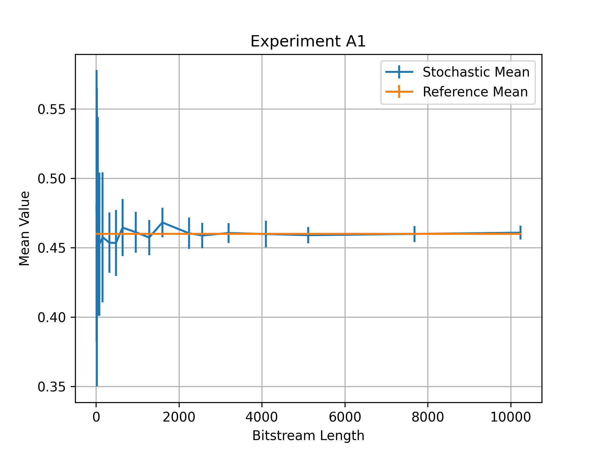
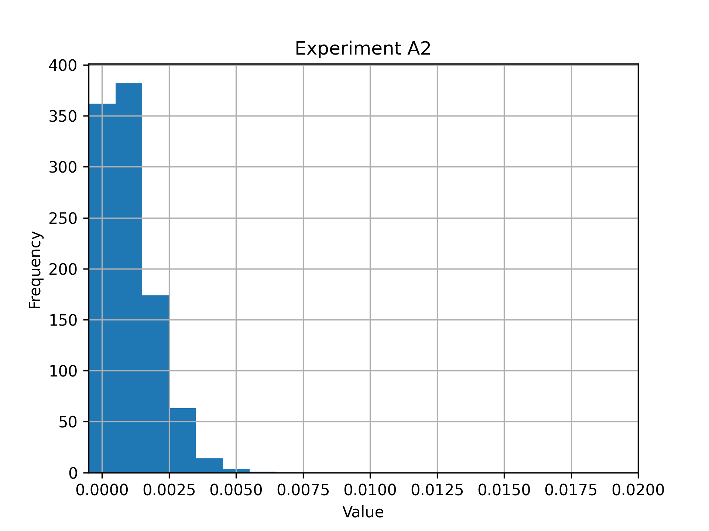
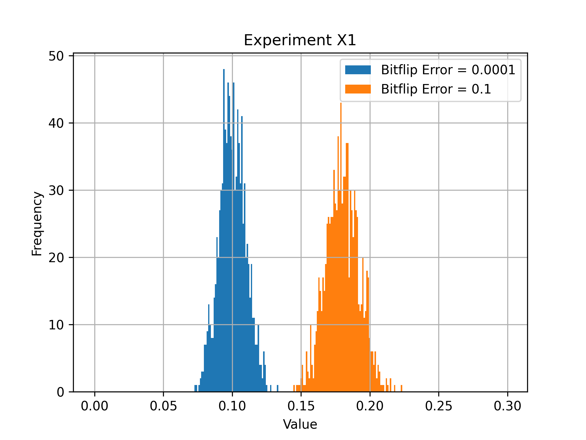
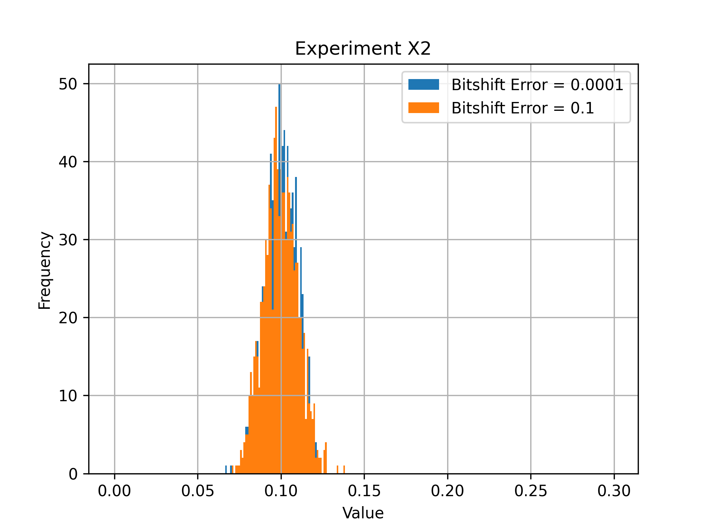
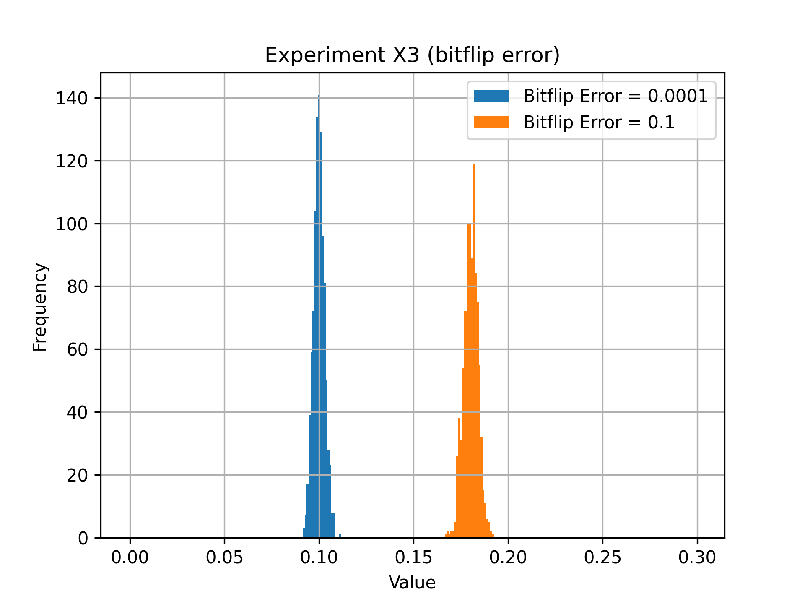
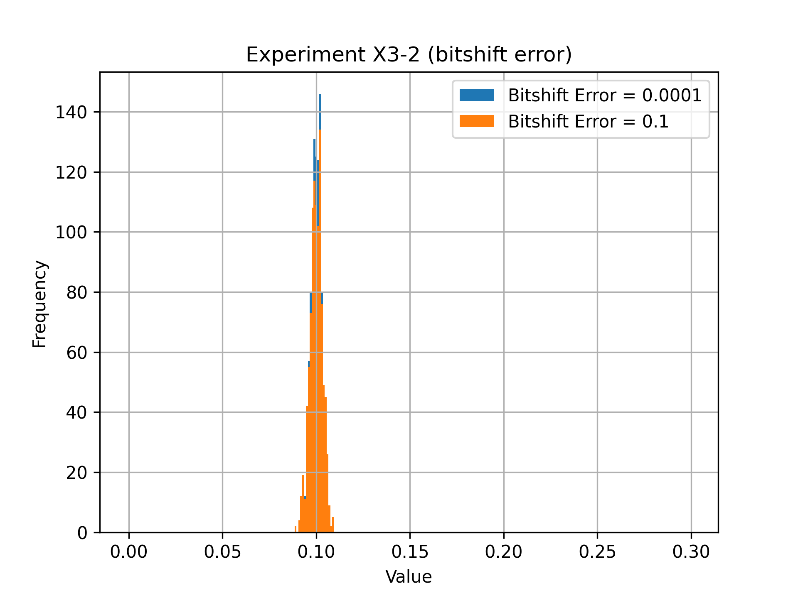

#### Part A: Stochastic Computing [2 pt/question, 8 points]

The provided scaffold code runs 10,000 trials of the `1/2*(0.8*0.4 + 0.6)` stochastic computation and plots the distribution of results. The `PART_A_example_computation` function executes the above numeric expression, and the `run_stochastic_computation` runs a stochastic computation for <ntrials> trials and plots the distribution + reports the mean and standard deviation of the stochastic executions. The vertical red line shows the expected result. Currently, the stochastic computing operations and value-to-bitstream / bitstream-to-value conversion routines are not implemented. 

Implement the stochastic computing paradigm by filling in the function stubs in the PosStochComputing class. Don't worry about supporting negative numbers just yet.

- `to_stoch` : convert a value in [0,1] to a stochastic bitstream.
- `from_stoch`: convert a stochastic bitstream to a numerical value
- `stoch_add`: perform scaled addition over two stochastic bitstreams.
- `stoch_mul`: perform multiplication over two stochastic bitstreams.

Execute the stochastic computation for bitstream lengths 10, 100, and 1000 with `stochastic.py`, and answer the following questions.

Q1. How does the mean change with increasing bitstream length? How does the variance change?

From the plot, we can see that both the difference between the mean and the reference value and the variance become smaller as the bitstream length increases.

Q2. What is the smallest representable numeric value in a single 1000-bit stochastic bitstream? What happens when you try to generate a bitstream for this value -- do the bitstream values converge to the desired value?

The smallest representable value for a single 1000-bit stochastic bitstream is 0.001 = 1/1000. 

When we try to generate a 1000-bit bitstream for the value 0.001, each stream may represent 0, 0.001, 0.002, and so on. From the plot, we can see that approximately 37.8% of the time, we get 0 rather than 0.001. However, most of the time, the value is either 0.000, 0.001, or 0.002.

Q3. What stochastic bitstream length L do we need to represent a rational number V accurately with a single bitstream, assuming V is in (0,1]? Write the equation. How does this L scale with V? Denote L' as the number bits needed to represent V accurately as an integer (removing the leading "0."). How does L' scale with V?

The minimum bitstream length L is the denominator of V when written in lowest terms. If V=a/b, then minimum value for L is b, with exactly a ones in the stream. There is no unique scaling relationship between L and the magnitude of V alone. For the special case V=1/b, L=1/V.

Q4. Design a stochastic computation for bitstreams with a length n=1000, such that the end result is not accurately representable by a single bitstream. You must accomplish this with stochastic operations, all initial values must be >= 0.1 and every constant must be a uniquely generated bitstream.

For any rational input A with $0.1 \le A < 1$, $A^4$ cannot be represented exactly by a single 1000-bit stochastic bitstream. Its reduced denominator is $b^4$, which cannot divide $1000=2^3\times5^3$. The exception among the allowed inputs is $A=1$.

#### Part X: Non-Idealities Stochastic Computing [2 pt/question, 6 points]

Next, we'll experiment with introducing non-idealities into the stochastic computation `1/2*(0.8*0.4 + 0.6)`. We will introduce two kinds of non-idealities:

- bit-shift errors: this class of errors result from timing issues in circuits. This non-ideality causes one bitstream to lag behind the other during computation. For example, a bit shift error at index 1 of a bit stream would transform some stream 00101 to 00010 (the 0 at index 1 is replicated). We do not consider the case where more than one bit shift occurs at the same index, as it is unlikely to happen in practice.

- bit-flip errors: this class of errors result from bit flips in storage elements, or in the computational circuit. This non-ideality introduces bit flips in bitstreams. For example, a bit flip error at index 1 of a bit stream would transform some stream 00101 to 01101.

Fill in the `apply_bitshift` and `apply_bitflip` functions in the stochastic computing class and apply these non-idealities at the appropriate points in the stochastic computing model. Make sure these non-idealities are only enabled for this section of the homework.

Q1. What happens to the computational results when you introduce a per-bit bit-flip error probability of 0.0001? What happens when the per-bit bit flip error probability is 0.1?

We set our reference value to 0.1. From the plot, we can see that when the bit-flip error probability is 0.0001, the results remain close to the reference value. When the error probability increases to 0.1, the peak of the distribution shifts away from the reference value, and the distribution of decoded bitstream values becomes wider. 

Q2. What happens to the computational results when you introduce a per-bit bit-shift error probability of 0.0001? What happens when the per-bit bit shift error probability is 0.1?

We set the reference value to 0.1. From the plot, we can see that there is no large difference for the peak of the distribution and the width of the distribution. This gives us the idea that bit shift error is not the type of errors that we need to concern for stochastic computing.

Q3. In summary, is the computation affected by these non-idealities? Do you see any changes in behavior as the bitstream length grows?

From Experiment X1 and Experiment X2 (1000-bit bitstream), we find out that bit flip error is a more critical error compare to bit shift error. When we change the the length of the bitstream to 10000, we find out that the width of the distribution decreases; however, the peak of the distribution still has the same amount of shift in bitflip error.

#### Part Y: Statically Analyzing Stochastic Computations [2 pt/question, 6 points]

Next, we'll build a simple static analysis for stochastic computations. A _static analysis_ is a type of analysis that is able to infer information about a program without ever running the computation. The analysis we will be building determines the minimum bitstream size necessary for a computation, given a set of precisions for each of the arguments. We define a bitstream size V to be sufficient if for any possible values t generated during the computation, V*t>=1. For example, to compute the bitstream length for the following expression:

    (x + y) + z

We will set up the static analyzer as follows:

    `analysis = StochasticComputingStaticAnalysis()`
    `analysis.stoch_add(analysis.stoch_add(prec_x, prec_y), prec_z)`
    `N = analysis.get_size()`

where `prec_x`, `prec_y`, and `prec_z` are the precisions of x, y, and z respectively. Precision of a variable is defined as the smallest value of the variable. If the precision of x is 0.01, the precision of y is 0.02 and the precision of z is 0.03, then the minimum bitstream length is 100. In this exercise, you will be populating the `StochasticComputingStaticAnalysis` class, which offers the following functions:

    - `stoch_var`, given a variable with a desired precision `prec`, update the static analyzer to incorporate this information.
    - `stoch_add`, given two stochastic bitstreams that can represent values with precision `prec1` and `prec2` respectively, figure out the precision required for the result stochastic bitstream given an addition operation is performed. Update the static analyzer to incorporate any new information.
    - `stoch_mul`, given two stochastic bitstreams that can represent values with precision `prec1` and `prec2` respectively, figure out the precision required for the result stochastic bitstream given a multiplication operation is performed. Update the static analyzer to incorporate any new information.
    - `get_size`, given all of the operations and variables analyzed so far, return the smallest possible bitstream size that accurately executes all operations, and can accurately represent all values.

We will use this static analysis to figure out what stochastic bistream length to use for the computation 1/2*(w*x + b), where the precision of w is 0.01, the precision of x is 0.1, and the precision of b is 0.1. For convenience, the scaffold file provides helper functions `PART_Y_analyze_wxb_function` for analyzing the `1/2*(w*x+b)` function, given a dictionary of precisions for variables `w`, `x`, and `b`, a `PART_Y_execute_wxb_function` which executes the `1/2*(w*x+b)` function using stochastic computing given a dictionary of variable values for `w`, `x`, and `b`, and a `PART_Y_test_analysis` function which uses the static analysis to find the best bitstream size for the `1/2*(w*x+b)` expresison, and then uses the size returned by the static analyzer to execute the `1/2*(w*x+b)` for ten random variable values that have the promised precisions.

Q1. Describe how your precision analysis works. Specifically, how do you propagate the precisions through the entire computation? How do you determine the final size?

We will have a variable under the class that store the current precision in self.result_prec. When we incorporate new variables or do computations, we will update the current precision. If today we are doing an add operation, we will change the precision to the minimum among the adding elements' precisions and self.current_prec. If today we are doing a multiplication operation, we will change the precision to the minimum among the product of multiplying elements and self.current_prec. 

Q2. What bitstream length did your analysis return?

1000

Q3. How did the random executions perform when parametrized with the analyzer-selected bitstream length?

Random execution results: (ref, mean, std)
1. (0.693000, 0.693011, 0.014378)
2. (0.442000, 0.441914, 0.015664)
3. (0.592000, 0.591881, 0.015367)
4. (0.424000, 0.423816, 0.015484)
5. (0.101000, 0.101031, 0.009411)
6. (0.200000, 0.199868, 0.012691)
7. (0.200000, 0.199991, 0.012751)
8. (0.384500, 0.384454, 0.015352)
9. (0.400000, 0.400091, 0.015626)
10.(0.429569, 0.429569, 0.015528)

From the experiment, we can see that using the analyzer-selected bitstream length, we can get the mean result that has difference to the reference value within the result precision from the static analysis. However, the standard variation still is bigger than the precision by a magnitude, making the result of the stochastic computing result have some uncertainty in it.
 
#### Part Z: Sources of Error in Stochastic Computing [2 pt/question, 4 points]

Next, we will investigate the `PART_Z_execute_rng_efficient_computation` stochastic computaton. This computation implements `1/2*(x*x+x)`, and implements an optimization (`save_rngs=True`) that reuses the bitstream for x to reduce the number of random number generators.

Q1. Does the accuracy of the computation change when the `save_rngs` optimization is enabled? Why or why not?

Experiment Results: (x, reference value, mean, std)
1. disabled: (0.3, 0.195000, 0.194605, 0.013205)
   enabled:  (0.3, 0.195000, 0.299410, 0.014588)
2. disabled: (0.1, 0.055000, 0.054791, 0.007326)
   enabled:  (0.1, 0.055000, 0.099903, 0.009534)
3. disabled: (0.8, 0.720000, 0.720011, 0.014957)
   enabled:  (0.8, 0.720000, 0.799761, 0.012669)

From the result, we can see that when save_rngs is enabled, the accuracy of the computation decreases. This is because using the same bitstream makes the the bitstreams correlate with one another and removes the randomness from the computation. 

Q2. Devise an alternate method for implementing $x*x+x$ from a single stochastic bitstream. There is a way to do this with a single (N+k)-bit bitstream, where k is a small constant value.

We know that the bits in the original stream are generated independently What we can do with a single (N+k)-bit bitstream is to shift the bitstream by a certain amount when we use it. For example, we can use bitstream[0:N], bitstream[1:N+1], and bitstream[2:N+2] when we do computation, and we can rotate back to the start of the bitstream when we are out of bits. The operations we are using can stay the same.
 
#### Part W: Extend the Stochastic Computing Paradigm [15 points]

Come up with your own extension, application, or analysis tool for the stochastic computing paradigm. This is your chance to be creative. Describe what task you chose, how it was implemented, and describe any interesting results that were observed. There is no need to pursue great results, e.g., beating some state-of-the-art approaches. It is fine to obtain minimum results just to show that your idea works. Here are some ideas to get you started:

- Implement a variant of stochastic computing, such as deterministic stochastic computing or bipolar stochastic computing. You may also modify the existing stochastic computing paradigm to incorporate a new source of hardware error -- you will need to justify your hardware error model. 

- Build an stochastic computing analysis of your choosing. You may build up the existing bitstream size analysis to work with abstract syntax trees, or you may devise a new analysis that studies some other property of the computation, such as error propagation or correlation.

- Implement an application using the stochastic computing paradigm. Examples from literature include image processing, ML inference, and LDPC decoding.

Image Processing 

I. Downsampling

We use the positive stochastic computation to downsample the given input image with different bitstream length. We compress the image to 1/16 of the original image. We implement it by using the nature of the addition operation to do the averaging. Below are the steps of how we do it:

1. Turn the picture into grayscale.
2. Map [0,255] to [0,1]
3. Use positive stochastic computation to compress every 4x4 matrix into 1x1. (The calculation is done by using a balanced adder tree with stoch_add.)
4. Get the compressed image.

Observation: (check experiment_W_images)
We test on different bitstream length. We find out that all the stochastic computed pictures contains some noise comparing to the reference picture. Moreover, the noise level decreases as we use longer bitstream. This result is consistent with what we get in Part A.

II. Edge Detection

After knowing that stochastic computation can successfully do image compression, we further analyze whether the stochastic computation is good for edge detection. 

The basic concept of edge detection is to find the color gradient of the image.

To find the difference, we will need to introduce a new operation stoch_diff.

This difference will be get by using the same sequence of random values and bitwise xor. By applying two thresholds (p1 and p2), we will get two different bitstream but correlated. When applying bitwise xor on these two bitstreams, we can get the difference of the probability |p1 - p2| directly. This derivation is true because the output bitstream will only get 1 when the generated random number is between p1 and p2. Therefore. it makes us easy to calculate the difference but with the condition that we use the same sequence of random values.

After knowing how to implement stoch_diff, it is easy for us to understand how to calculate the gradient. Given a 2*2 pixel = [[a,b],[c,d]], the gradient = stoch_add(stoch_diff(a,b),stoch_diff(c,d)).

Observation: (check experiment_W_images)
From the experiment, we can see that we get clearer edges when we use longer bitstream. Some weak gradients appear more prominent with shorter bitstreams, possibly because sampling noise increases their estimated intensity. However, this noise can also create false edges, so greater visibility does not necessarily indicate more accurate edge detection.

