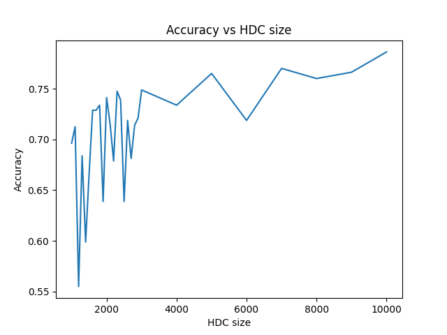
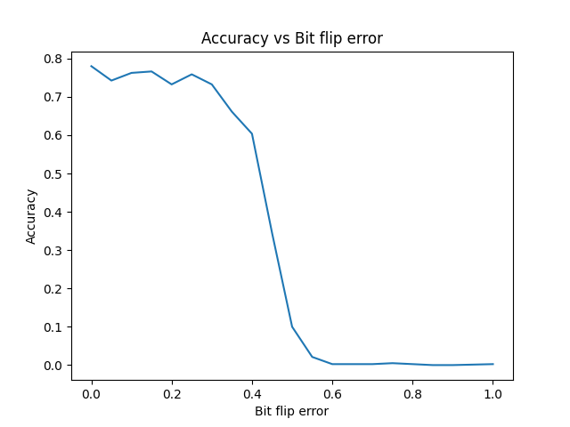
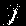
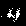
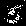
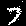
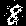

### Part A: Hyperdimensional Computing [8 pts total, 2 pts / question]

**Task 1:** In `hdc.py`, implement the hypervector generation, binding, bundling, Hamming distance, and permutation operations in the scaffold code. Also, implement the `add` and `get` functions in the item memory `HDItemMem` class; these functions will be used to manage the atomic hypervectors. Based on them, implement an HD encoding procedure that encodes strings in `make_word` function. You should also implement the `make_letter_hvs` function. It should produce a codebook for the letters, which serves as the first argument for the `make_word` function. Refer to the main scripts for how these two functions are invoked in sequence.

For example "fox" would be translated to sequence ["f","o", "x"]. For simplicity, use a hypervector size of 10,000 to answer these questions unless otherwise stated.

**Q1.** Construct a HDC-based string encoding for the word "fox". How did you encode the "fox" string? How similar is the hypervector for "fox" to the hypervector for "box" in your encoding? How similar is the hypervector for "xfo"? How similar is the hypervector for "car"? Please remark on the relative similarities, not the absolute distances.

The way we encode the "fox" string is bundle(permute('f',0), permute('o',1), permute('x',2)).

These are the results I get from the simulation:
1. distance between fox and box: 0.247800
2. distance between fox and xfo: 0.503100
3. distance between fox and car: 0.496100

The results show that “fox” is much more similar to “box” than to either “xfo” or “car.” This is because “fox” and “box” share their last two letters in the same positions. 

Though “xfo” contains the same letters as “fox,” each letter appears in a different position and therefore receives a different permutation. Therefore, “xfo” and “car” are approximately equally dissimilar to “fox” in this encoding.

**Q2.** Change your encoding so the order of the letters doesn't matter (apply the changes for this question only). What changes did you make? Please remark on the relative similarities, not the absolute distances.

The hamming distances result I get from the experiment:
1. distance between fox and box: 0.251100
2. distance between fox and xfo: 0.000000
3. distance between fox and car: 0.501800

We removed the permutation operations from the encoding so that letter order no longer affects the resulting hypervector. Because bundling is commutative within one operation (i.e. bundle(a,b,c) = bundle(c,b,a)), “fox” and “xfo” produce identical hypervectors. “fox” and “box” are also relatively similar because they share the letters “o” and “x.” In contrast, “car” is much less similar to “fox” because the two words have no letters in common.

-------

**Task 2:**: Implement the bit flip error helper function (`apply_bit_flips`). Then apply bit flip errors to hypervectors before the distance calculations, where the bit flip probability is 0.10. Specifically, before computing the distance between two hypervectors hv1 and hv2, you may apply the bit flip error to one of them, say hv1. Use the `monte_carlo`, `study_distributions`, and `plot_hist_distributions` helper functions to study the distribution of distances between `fox` and `box`, compared to the distance between `fox` and `car` with and without hardware error.

**Q3.** Try modifying the hardware error rate (`perr`) with fixed hypervector size `10000`. How high can you make the hardware error until the two distributions begin to become visibly indistinguishable? What does it mean conceptually when the two distance distributions have a lot of overlap?

The experimental plots are stored in images/A3. We observed that at an error rate of 0.5, the distance distributions for “fox”–“box” and “fox”–“car” become visibly indistinguishable. At this error rate, each bit of the corrupted hypervector is effectively random, eliminating the similarity advantage that “box” originally had over “car.”

Conceptually, substantial overlap means that distance to “fox” is no longer a reliable way to distinguish a similar word from an unrelated word.

**Q4.** Try modifying the hypervector size (`SIZE`) with fixed hardware error rate `0.10`. How small can you make the word hypervectors before the two distributions begin to become visibly indistinguishable?

The experimental plots are stored in images/A4. The shortest hypervectors can be 40 bits. When the hypervecctors have the length smaller than 40 bits, we find out that around 30% of the distribution overlap with each other making us hard to tell whether these two hypervectors are the same or not.

-----

**Task 3:**: Next, fill out the stubs in the item memory class -- there are stubs for threshold-based (`matches`) and winner-take-all (`wta`) queries, and for computing the Hamming distances between item memory rows and the query hypervector. The item memory class will be used in later exercises to build a database data structure and an ML model.

### Part B: Item Memories [`hdc-db.py`, 10 points total, 2 pts / question]

Next, we will use this item memory to implement a database data structure; we will be performing queries against an HDC-based database populated with the digimon dataset (`digimon.csv`). The HDDatabase class implements the hyperdimensional computing-based version of this data structure, and contains stubs of convenience functions for encoding / decoding strings and database rows, as well as stubs for populating and querying the database. We will implement this class and then invoke `build_database` to build a database using the HDDatabase class. For simplicity, use a hypervector size of 10,000 to answer these questions unless otherwise stated.

_Tip_: For this exercise, map every distinct string to an atomic random hypervector. This will keep retrieval tasks relatively simple. For decoding operations, you will likely need to use the self-inverse property of binding and perform additional lookups to recover information.

---------

__Task 0__: The database data structure contains multiple rows, where each row is uniquely identified with a primary key and contains a collection of fields that are assigned to values. In the HD implmentation, the database rows are maintained in item memories, and row data is encoded as a hypervector. Decide how you want to map the database information to item memories. Implement the database row addition `add_row` function, which should invoke the `encode_row` helper function and update the appropriate item memories.

---------

__Task 1__: Implement the string and row encoding functions (`encode_string`, `encode_row`). These encoding functions accept a string and a database row (field-value map) respectively, and translate these inputs into hypervectors by applying HD operators to atomic basis vectors. Then, implement the string and row decoding functions (`decode_string`, `decode_row`) which take the hypervector representations of a string or database row respectively and reconstructs the original data. The decoding routines will likely need to perform multiple codebook / item memory lookups and use HD operator properties (e.g., unbinding) to recover the input data. Execute `digimon_test_encoding` function to test your string and row encoding routines and verify that you're able to recover information from the hypervector embedding with acceptable reliability.

**Q1.** Describe how you encoded database rows as hypervectors. Write out the HD expression you used to encode each piece of information, and describe any atomic hypervectors you introduced.

I use four data structures to store the hypervector representations:
1. self.db stores the encoded database rows.
2. self.field_codebooks stores the hypervectors representing field names.
3. self.value_codebooks (one value codebooks for all fields) stores the hypervectors representing the possible values in each column.
4. self.string_codebooks stores the hypervectors representing complete strings.

The atomic hypervectors are randomly generated binary vectors representing field names and distinct values. Each complete string is represented by a hypervector rather than being constructed from letter hypervectors.

To encode a row, I bind each field hypervector to its corresponding value hypervector using bitwise XOR and then bundle all the field–value pairs together using majority voting:
hv(row) = bundle(bind(hv(field_1), hv(value_1)), bind(hv(field_2), hv(value_2)), ..., bind(hv(field_3), hv(value_3))).

**Q2.** Describe how you decoded the strings / database rows from hypervectors. Describe any HD operations you used to isolate the desired piece of information, and describe what item memory lookups you performed to recover information. If you're taking advantage of any HD operator properties to isolate information, describe how they do so.

To decode a string hypervector, I compare it with the stored hypervectors in the string codebook using Hamming distance and return the key having the closest match. This retrieves the complete string because strings are represented directly by hypervectors rather than encoded letter by letter.

To decode a database row, I query each known field separately. For each field, I bind its hypervector with the row hypervector. Since XOR is self-inverse, the field hypervector cancels within its corresponding field–value pair and reveal the value. The other field-value pairs contribute interference. I then compare the query with the candidate value hypervectors in the value codebook and return the value with the smallest Hamming distance.

--------

__Task 2__: Next, we'll implement routines for querying the data structure. Implement the `get_value` and `get_matches` stubs -- the `get_value` query retrieves the value assigned to a user-provided field within a record. The `get_matches` stub retrieves the rows that contain a subset of field-value pairs. Implement both these querying routines and then execute `digimon_basic_queries` and `digimon_value_queries` to test your implementations.

**Q3.** How did you implement the `get_value` query? Describe any HD operators and lookups you performed to implement this query.

Similar to `decode_row`, `get_value` first bind the field hypervector with the row hypervector. Then, we compare the result with value codebook and return the field-value pair with smallest Hamming distance.

**Q4.** How did you implement the `get_matches` query? Describe any HD operators and lookups you performed to implement this query. Try using lower threshold values. How high of a distance threshold can you set before you start seeing false positives in the returned results?

We first encode the field-value pairs into a query hypervector with 'encode_row' and find all the rows whose distance is below the specific threshold. 

The experimental result for threshold testing:
threshold=0.430000
===== virus-plant query =====
---- # matches = 7 ----
true matches=7, false matches=0
===== champion query =====
---- # matches = 54 ----
true matches=54, false matches=0
---
threshold=0.440000
===== virus-plant query =====
---- # matches = 22 ----
true matches=7, false matches=15
===== champion query =====
---- # matches = 54 ----
true matches=54, false matches=0

We find out that 0.43 is the highest threshold we can set before we start seeing false positive. Increase upon 0.43 will introduce false positive to the virus-plant query.

---

__Task 3__: Implement the `get_analogy` query, which given two records and a value in one of the records, identifies the value that shares the same field in the other record as the input value. For example, if you perform an `analogy` query on the `US` and `Mexico` records, and ask for the value in the `Mexico` record that relates to the `Dollar` value in the `US` record, this query would return `Peso`. This query completes the analogy  _Dollar is to USA as <result> is to Mexico_. Execute `analogy_query` to test your implementation.

_Tip_: If you want more information on this type of query, you can look up "What We Mean When We Say 'What's the Dollar of Mexico?'"

**Q5.** How did you implement the `get_analogy` query? Describe how this is implemented using HD operators and item memory lookups. Why does your implementation work? You may want to walk through and HD operator properties you leveraged to complete this query.

Similar to `get_value`, `get_analogy` uses binding to retrieve an associated piece of information.First, we bind the source row hypervector with the given value’s hypervector. We compare the resulting hypervector with the field hypervectors in the field codebook and select the field with the smallest Hamming distance. We then call get_value with this field and the other row to retrieve the corresponding value.

Because the row bundles multiple field–value pairs, this operation produces a noisy approximation of the field hypervector. The nearest-match lookup in the field codebook recovers the intended field, provided the interference is sufficiently small.

### Part C: Implementing an HDC Classifier [10 pts total, 2 pts/question, hdc-ml.py]

Next, we will use an item memory to implement an MNIST image classifier. A naive implementation of this classifier should easily be able to get ~75% accuracy. In literature, HDC-based MNIST classifiers have been shown to achieve ~98% classification accuracy with model size of only a few bytes while being error resilient. In this exercise, you will implement the necessary encoding/decoding routines, and you will implement both the training and inference algorithms for the classifier.

__Tips__: Try a simple pixel/image encoding first. For decoding operations, you will likely need to use the self-inverse property of binding to recover information.

-------------

**Task 1**: Fill in the `encode_pixel`, `decode_pixel`, `encode_image`, and `decode_image` stubs in the MNIST classifier. These functions should translate pixels/images to/from their hypervector representation. Then use the `test_encoding` function to evaluate the quality of your encoding. This function will save the original image to `sample0.png`, and the encoded then decoded image to `sample0_rec.png`.

**Q1.** How did you encode pixels as a hypervector? Write out the HD expressions, and describe what atomic/basis hypervectors you used for the encodings. 

I uses 3 atomic hypervectors: "black", "white", and "loc." The first two represent the possible pixel colors, while the third serves as the basis for generating location hypervectors.

For a pixel at coordinates (i,j), we permute the location hypervector by (iW+j), where (W) is the image width. We then bind the resulting location hypervector with the pixel’s color hypervector.

**Q2.** How did you encode images as a hypervector? Write out the HD expressions, and describe any atomic/basis hypervectors in the expression. 

After getting the hypervectors of each pixel, we bundle them together to form the hypervector for the image.

-----------------------

**Task 2**: Fill in the `train` and the `classify` stubs in the MNIST classifier. Test your classifier out by invoking the `test_classifier` function. What classification accuracy did you attain? You should be able to achieve ~75% with the standard techniques learned in class. We will give full credit for accuracy about or above 75%.

**Q3.** What happens to the classification accuracy when you reduce the hypervector size; how small of a size can you select before you see > 5% loss in accuracy? 

The experimental plot is stored in images/accuracy_vs_hdc_size.png. The results show that the accuracy generally decreases as the hypervector size decreases. Compared with the baseline accuracy at the original hypervector size, the accuracy drops by more than 5% when the size falls below 3000. Therefore, 3000 is the smallest tested size that keeps the accuracy loss within 5 percentage points.

**Q4.** What happens to the classification accuracy when you introduce bit flips into the item memory's distance calculation? Note that you shold only apply bit flips during inference. How much error can you introduce before you see a > 5% loss in accuracy?

The experimental plot is stored in images/accuracy_vs_bit_flip_error.png. Classification accuracy decreases as the bit flip probability increases, with a particularly sharp decline above 0.35. At a bit flip probability of 0.5, accuracy falls below 10%.

------------------------

**Task 3**: You can also implement a simple generative model using hyperdimensional computing. In this following exercise, we will use HDC to generate images of handwritten digits from the classifier label. Naive HD generative models are very similar to HD classifiers, and are constructed in two simple steps:

- _Constructing a Generative Model._ For each classifier label, group training data by label, and translate each datum to a hypervector. Next, generate a probability vector for each label. The probability value at position i of the probability vector is the probability that the hypervector bit in position i is a "1" bit value. The probability vector can easily be computed by summing up the M hypervectors that share the same label, and then normalizing by 1/M.

- _Generating Random Images._ To generate a random image for some label, you sample a binary hypervector from the probability hypervector for that label. You then translate the hypervector to an image using the hypervector decoding routine (`decode_image`). You can sample and bundle multiple hypervectors to average the result.

You can find a sample of generated image `sample_generated.png` for number `7` in the folder.

**Q5.** Use `test_generative_model` function to test your generative model. Include a few pictures outputted by your generative model in your submission.

The generated images in the folders images/C5.
